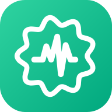
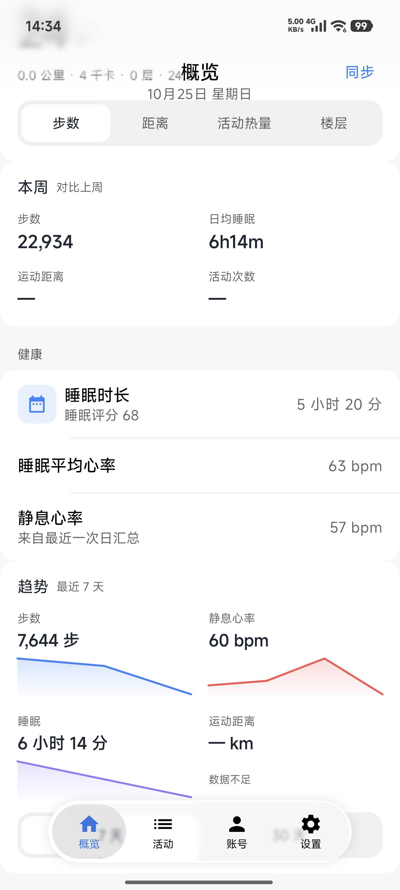
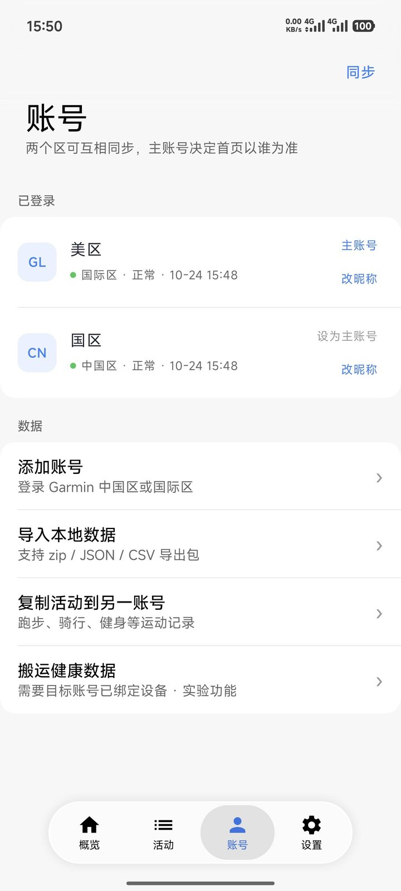
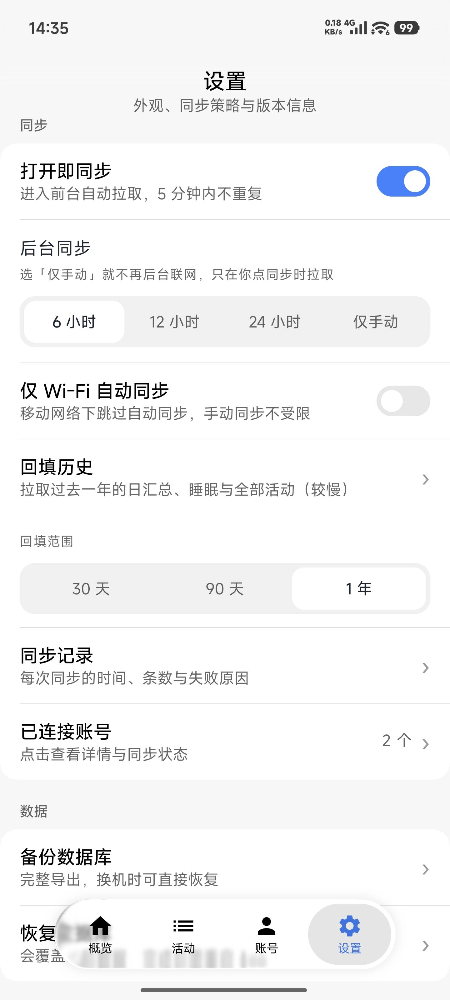

<div align="center">
  

# FitSync

One app for both of your Garmin accounts: steps, sleep, heart rate and workouts in one place.


[简体中文](README.md) | **English**
</div>

## ✨ Features

| | | |
|:---:|:---:|:---:|
| **🧩 Two regions**<br>Mainland China and International accounts side by side, merged locally | **🔁 Workout transfer**<br>Copy activities to the other account — no re-recording after switching regions | **🏃 Workout detail**<br>Pace, heart rate and elevation curves, plus a shareable summary card |
| **📊 Trends & weekly**<br>7 / 30-day changes, plus this week vs last week | **🛌 Sleep stages**<br>Deep, light, REM and awake in one colour band | **⏳ Backfill**<br>Page through every activity; a year of daily health data |
| **📑 Laps & zones**<br>Per-km pace, cadence and power curves, heart-rate zone split | **🎛️ Sync policy**<br>Every 6/12/24 hours or manual only; Wi-Fi-only option | **🩺 Health migration**<br>Forwards the device's original wellness package (steps, sleep, stress) |
| **🔐 Local first**<br>Data stays on the phone; tokens encrypted with Tink | **📤 Export**<br>Re-importable JSON, or three CSV tables | **💾 Backup**<br>One-tap database backup, restore on a new phone |
| **🌗 Dark mode**<br>Follow system / light / dark, applied instantly | **🔍 Filter & search**<br>By sport, month, or name | **🧾 Sync log**<br>Time, record count and failure reason for every run |

## 📱 Screenshots

| Overview | Accounts | Settings |
|:---:|:---:|:---:|
|  |  |  |

- Built on [Miuix](https://github.com/YuKongA/miuix) 0.9.4 (theme, cards, switches, list rows, floating navigation),
  plus in-house components: `HyperPage`, the liquid-glass navigation bar, segmented control, input and confirm dialogs
- Liquid-glass bar with real backdrop blur, refraction and dual-light highlights; spring-driven indicator that follows your drag
- Collapsing large title, rubber-band list edges, progressive top-bar blur
- Four tabs: Overview / Activities / Accounts / Settings; haptic feedback can be turned off

> The glass effect needs Android 13 (API 33) RuntimeShader; older versions fall back to translucency with a highlight stroke.

## 📖 Getting started

1. Open [Releases](https://github.com/yaoiwi/FitSync/releases/latest) and download `FitSync-1.14.3.apk` (install over the old version; settings are kept).
2. Open the app, tap "Add account" and sign in to Garmin China or Garmin International (MFA supported)
3. Pull to refresh — the first sync backfills 7 days; afterwards it syncs on open and every 6 hours in the background
4. With both accounts added, use "Accounts → Data" to copy activities, migrate health data, or export your local records

> Each release also includes `apk-sha256`; verify with `sha256sum -c apk-sha256`.

> Versioning: regular releases step `1.13` → `1.14`; small fixes use three parts such as `1.14.1`.

- Requires **Android 8.0 (API 26)** or newer
- The liquid-glass effect requires **Android 13 (API 33)**; older versions degrade gracefully
- Found a problem? Open an [issue](https://github.com/yaoiwi/FitSync/issues). Build and signing notes are below

## 🔨 Build

You need JDK 17 and Android SDK 37:

```bash
./gradlew :app:test
./gradlew :app:assembleRelease
```

Output: `app/build/outputs/apk/release/app-release.apk`

<details>
<summary>Signing (development / release)</summary>

Signing switches on environment variables, so builds never end up with a random signature.

**Default: the checked-in debug keystore**

`signing/debug.keystore` is committed with Android's public credentials (`android` / `androiddebugkey`). Used when no secrets or environment variables are configured. ⚠️ It cannot be published to an app store.

**Release: your own keystore**

```bash
# 1. Generate (Termux or a desktop with a JDK)
keytool -genkeypair -v -keystore fitsync-release.jks -alias fitsync \
  -keyalg RSA -keysize 2048 -validity 10000 -storetype JKS \
  -storepass YOUR_PASSWORD -dname "CN=FitSync, OU=Dev, O=yaoiwi, C=CN"

# 2. Base64, single line
base64 -w 0 fitsync-release.jks
```

Add four secrets under `Settings → Secrets and variables → Actions`: `KEYSTORE_BASE64`, `KEYSTORE_PASSWORD`, `KEY_ALIAS`, `KEY_PASSWORD`. The `Prepare signing` CI step decodes them; locally, export `KEYSTORE_PATH`, `KEYSTORE_PASSWORD`, `KEY_ALIAS` and `KEY_PASSWORD`.

> Once you switch from debug to release, uninstall the old build before installing the new one.

```bash
# Verify: both commands should print the same fingerprint
keytool -list -v -keystore fitsync-release.jks -alias fitsync -storepass YOUR_PASSWORD | grep SHA256
apksigner verify --print-certs app-debug.apk | grep SHA-256
```

</details>

## ⚠️ Disclaimer

- This project uses Garmin's non-public endpoints. They **can break at any time**, and accounts may be rate-limited or flagged
- Only use it to sync **your own** accounts
- Not an official client; not affiliated with Garmin Ltd. Garmin is a trademark of Garmin Ltd.
- Use at your own risk. The author is not responsible for account restrictions or data loss

## ⭐ Star History

[](https://star-history.com/#yaoiwi/FitSync&Date)

## 📄 License

[Apache-2.0](LICENSE). Free to use, modify and distribute, **including commercial and closed-source derivatives**, as long as the copyright notice and license text are kept. Includes an express patent grant (terminated if you sue over patents).

Third-party licenses and the upstream source of the liquid-glass code are listed in [THIRD_PARTY_NOTICES.md](THIRD_PARTY_NOTICES.md).

### About the DailySync reference

The health-data transfer feature was informed by [DailySync (dailysync-rev)](https://github.com/gooin/dailysync-rev), which is released under **GPL-3.0**. This project only borrows the Garmin endpoints and semantics it uses (downloading the daily wellness package from `download-service/files/wellness/{date}`, uploading with the `userfile` field, treating HTTP 409 as a duplicate). The implementation here is independent Kotlin code: **no upstream source was copied, translated, or adapted**. FitSync is therefore not a derivative work of GPL-3.0 code and remains licensed under Apache-2.0, with no GPL code in the APK or source archive. See [THIRD_PARTY_NOTICES.md](THIRD_PARTY_NOTICES.md) for the full note.

<div align="center">

Made with ❤️ for Garmin users


</div>
